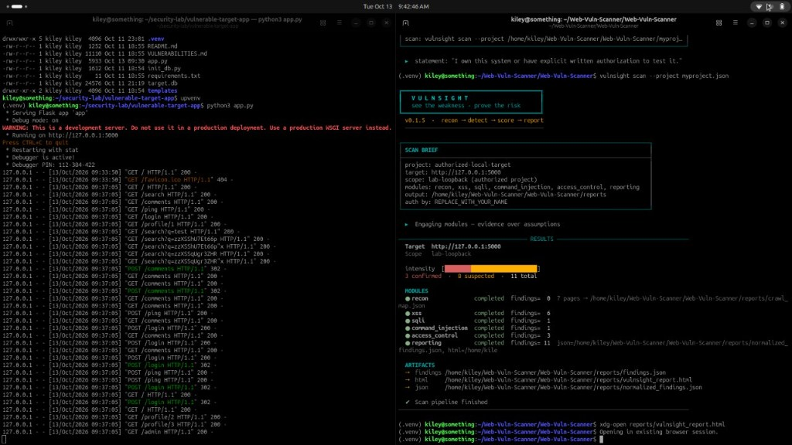
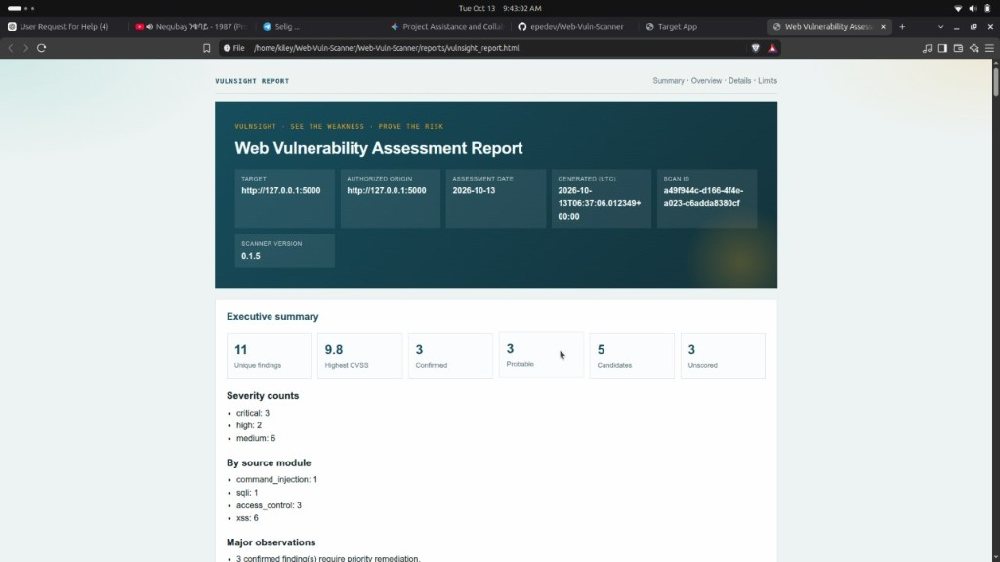
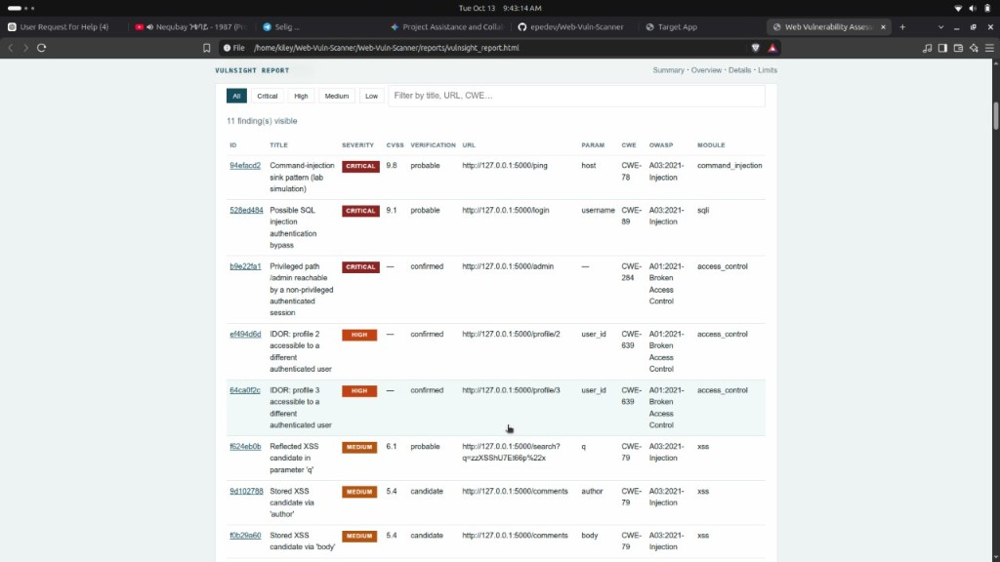

# VulnSight

**Modular CLI web vulnerability scanner for authorized local assessments.**

[](https://www.python.org/)
[](LICENSE)
[](tests/)
[](CHANGELOG.md)

VulnSight integrates reconnaissance, injection detection, XSS analysis, access-control checks, and professional reporting into a single authorized-use CLI pipeline. It is designed as a modular graduation project: each detection area remains independently maintainable while sharing a common findings contract.

**Group 3**

| Student name | Student ID |
|--------------|------------|
| Kenean Amare Eshetu | CTC-4837-26 |
| Kenneti Hailu Dange | CTC-535-26 |
| Kidsit Ephrem | CTC-6744-26 |
| Alazar Elias Digafe | CTC-631-26 |
| Firaol Mustefa Gossa | CTC-4301-26 |

See also [AUTHORS.md](AUTHORS.md).

> **Authorized use only.** Scan only systems you own or have written permission to test. This repository does **not** include a vulnerable target application—operators provide their own local website.

---

## Features

- Project-file authorization (`init-project` / `scan --project`)
- Same-origin crawler producing `crawl_map.json`
- Detection modules: XSS, SQL injection, command injection, access control
- Security hygiene module: headers, cookies, CSRF candidates, open redirect
- Secure-vs-vulnerable comparison (`vulnsight compare`) for academic controls
- Threat model + assessment-quality guidance in HTML reports
- CVSS-aware reporting with HTML, Markdown, PDF, and JSON outputs
- Lab-first scope defaults (loopback) with explicit opt-in for external targets
- Interactive documentation site (`vulnsight docs`)

---

## Requirements

- Python 3.10+
- An authorized local website under test
- Optional: WeasyPrint or ReportLab for PDF reports

---

## Installation

```bash
git clone https://github.com/epedev/Web-Vuln-Scanner.git
cd Web-Vuln-Scanner

python3 -m venv .venv
source .venv/bin/activate          # Windows: .\.venv\Scripts\Activate.ps1

pip install -e ".[dev]"
vulnsight doctor
```

---

## Quick start

```bash
# 1. Start your prepared local website (example: http://127.0.0.1:5001)

# 2. Create an authorization project file
vulnsight init-project -o myproject.json --target http://127.0.0.1:5001

# 3. Run the full pipeline
vulnsight scan --project myproject.json
```

Reports are written under `reports/`:

| Artifact | Description |
|----------|-------------|
| `vulnsight_report.html` | Interactive report with download controls |
| `vulnsight_report.md` | Markdown report |
| `vulnsight_report.pdf` | PDF report |
| `findings.json` | Machine-readable findings |

---

## Project demonstration

Authorized local scan against a prepared vulnerable target, with VulnSight producing an assessment report.







---

## Secure vs vulnerable comparison

```bash
vulnsight compare \
  --current reports/findings.json \
  --baseline fixtures/secure_baseline_findings.json \
  --output reports
```

---

## Architecture

```
Authorize → Recon → Detect (XSS / SQLi / Cmd / Access / Hygiene) → Report
```

| Module | Path | Responsibility |
|--------|------|----------------|
| Orchestrator / CLI | `vulnsight/` | Project auth, scope, scan orchestration |
| Reconnaissance | `Crawler/` | Same-origin crawl map |
| XSS | `xss_module/` | Reflected and stored XSS |
| Injection | `sqli_&_command_module/` | SQL injection and command injection |
| Access control | `access_control_module/` | IDOR and broken access control |
| Security hygiene | `misconfig_module/` | Headers, cookies, CSRF, open redirect, SSRF candidates, tech disclosure |
| OWASP Top 10:2025 | `reporting_module/` + `docs/OWASP_TOP10.md` | 2025 coverage + 2021 continuity tables in HTML/MD reports |
| Reporting | `reporting_module/` | Normalization, CVSS, HTML / MD / PDF / JSON |

---

## Documentation

| Document | Description |
|----------|-------------|
| [docs/index.html](docs/index.html) | Project overview (open with `vulnsight docs`) |
| [docs/USAGE.md](docs/USAGE.md) | CLI usage |
| [docs/INSTALLATION.md](docs/INSTALLATION.md) | Setup notes |
| [docs/ARCHITECTURE.md](docs/ARCHITECTURE.md) | Module contracts |
| [docs/DEMO_RUNBOOK.md](docs/DEMO_RUNBOOK.md) | Demonstration checklist |
| [docs/SECURITY.md](docs/SECURITY.md) | Authorized-use policy |
| [docs/THREAT_MODEL.md](docs/THREAT_MODEL.md) | Threat model & FP/FN guidance |
| [AUTHORS.md](AUTHORS.md) | Project contributors |

---

## Testing

```bash
python -m pytest
```

Optional live target:

```bash
export VULNSIGHT_LAB_URL=http://127.0.0.1:5001
python -m pytest tests/integration -q
```

---

## Security

See [SECURITY.md](SECURITY.md) and [docs/SECURITY.md](docs/SECURITY.md).  
Crawler discovery is not authorization. Prefer loopback targets for academic demos.

---

## License

This project is released under the [MIT License](LICENSE).
