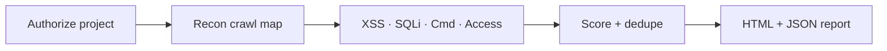

# VulnSight

```text
╔══════════════════════════════════════════╗
║   V U L N S I G H T                      ║
║   see the weakness · prove the risk      ║
╚══════════════════════════════════════════╝
```

**Modular CLI web vulnerability scanner for authorized local assessments.**

[](https://www.python.org/)
[](LICENSE)
[](docs/USAGE.md)
[](docs/index.html)

> **Authorization required.** Scan only systems you own or have written permission to test. VulnSight does **not** ship a vulnerable target — bring your own authorized local website.

---

## Interactive docs

Open the visual guide in a browser:

```bash
vulnsight docs
# or: open docs/index.html
```

---

## Pipeline



| Stage | What happens |
|-------|----------------|
| **Authorize** | `init-project` writes an explicit permission file |
| **Recon** | Same-origin crawl → `crawl_map.json` |
| **Detect** | XSS, SQLi, command injection, access control |
| **Report** | Interactive HTML + machine-readable JSON |

---

## Install once

```bash
git clone https://github.com/epedev/Web-Vuln-Scanner.git
cd Web-Vuln-Scanner

python3 -m venv .venv
source .venv/bin/activate   # Windows: .\.venv\Scripts\Activate.ps1

pip install -e ".[dev]"
vulnsight doctor
```

---

## Scan in three commands

```bash
# 1) Start YOUR prepared local website (example port 5001)

# 2) Authorize it
vulnsight init-project -o myproject.json --target http://127.0.0.1:5001

# 3) Run every module + write the report
vulnsight scan --project myproject.json
```

Open:

- `reports/vulnsight_report.html` — filterable findings UI
- `reports/findings.json` — machine-readable output

---

## Repository map

| Path | Role |
|------|------|
| [`vulnsight/`](vulnsight/) | CLI · project auth · orchestrator · terminal UI |
| [`Crawler/`](Crawler/) | Reconnaissance |
| [`xss_module/`](xss_module/) | Reflected / stored XSS |
| [`sqli_&_command_module/`](sqli_&_command_module/) | SQLi + command injection |
| [`access_control_module/`](access_control_module/) | IDOR + broken access control |
| [`reporting_module/`](reporting_module/) | CVSS + interactive HTML reports |
| [`docs/index.html`](docs/index.html) | Interactive project showcase |

---

## Docs

| Guide | Link |
|-------|------|
| Interactive home | [docs/index.html](docs/index.html) |
| Usage | [docs/USAGE.md](docs/USAGE.md) |
| Installation | [docs/INSTALLATION.md](docs/INSTALLATION.md) |
| Architecture | [docs/ARCHITECTURE.md](docs/ARCHITECTURE.md) |
| Demo runbook | [docs/DEMO_RUNBOOK.md](docs/DEMO_RUNBOOK.md) |
| Security | [docs/SECURITY.md](docs/SECURITY.md) |

---

## Tests

```bash
python -m pytest
```

Optional live lab (your site):

```bash
export VULNSIGHT_LAB_URL=http://127.0.0.1:5001
python -m pytest tests/integration -q
```

---

## License

MIT — see [LICENSE](LICENSE).
