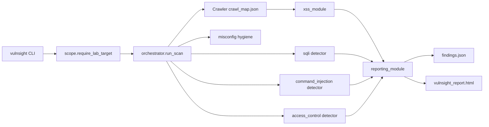

# Architecture

VulnSight is a modular monorepo integrated by a thin CLI/orchestrator. It scans an operator-provided authorized website; it does not ship a vulnerable target app.

## Five-person ownership

| Member | Path | Public interface | Contract |
|--------|------|------------------|----------|
| 1 Recon | `Crawler/` | `run_crawler_module(...)` | `crawl_map.json` schema v1.0 |
| 2 Injection | `sqli_&_command_module/` | `check_local_target(base_url)` | `ScanResult` / `Finding` |
| 3 XSS | `xss_module/` | `run_xss_module(...)` | `ScanResult` + crawl map consumer |
| 4 Auth/AC | `access_control_module/` | `check_local_target(base_url)` | Lab identities + `ScanResult` |
| 5 Reporting | `reporting_module/` | `run_report_module(...)` | Canonical findings + OWASP Top 10:2025 (+2021 continuity) + HTML/JSON |
| Hygiene | `misconfig_module/` | `check_local_target(base_url, crawl_map)` | Headers/CSRF/cookies/redirect/SSRF/disclosure |

## Shared models

- Detection findings: `xss_module/scanner/models.py` (`Finding`, `ScanResult`)
- Reporting canonical schema: `reporting_module/reporting/schema.py`
- Orchestrator adds member directories to `sys.path` via `vulnsight/paths.py`

## Adding a new detection module

1. Accept a validated `crawl_map.json` and/or explicit lab URL.
2. Emit `Finding` objects via `scanner.models` (or JSON compatible with reporting normalization).
3. Register the module name in `vulnsight.config.ALL_MODULES` and call it from `vulnsight.orchestrator`.
4. Add unit tests plus optional live tests behind `VULNSIGHT_LAB_URL`.
5. Document ownership in this file and `docs/MODULE_GUIDE.md`.

## Safety

- Explicit `--target` or authorized `--project` file required
- Default allowlist: `127.0.0.1` / `localhost` / `::1` over HTTP
- Redirects re-checked inside crawler and XSS HTTP engines
- Module failures preserve findings from successful modules and mark coverage partial
