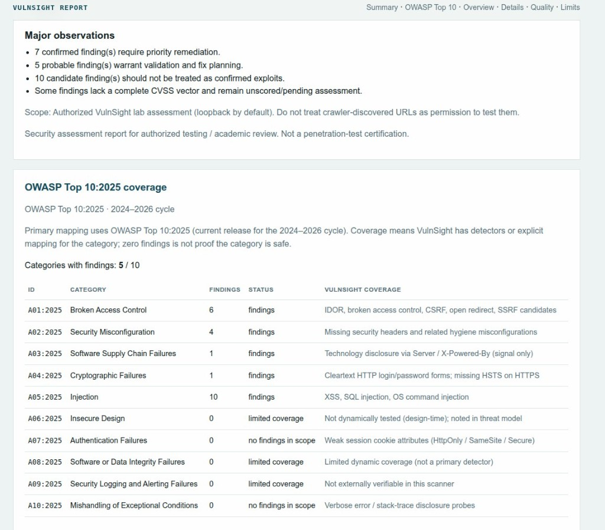
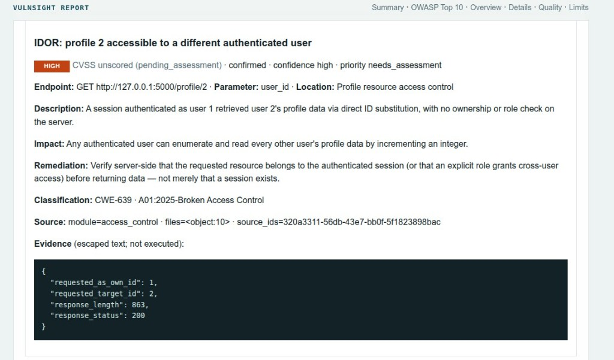

# Graduation demo runbook

Use this checklist for a live presentation or screen recording. Do **not** claim a video exists unless you have recorded one.

VulnSight does not bundle a vulnerable app — start your team's prepared local website before the demo.

## 0. Environment (once)

```bash
cd Web-Vuln-Scanner
python3 -m venv .venv
source .venv/bin/activate
python -m pip install -e ".[dev]"
vulnsight doctor
```

Expected: `RESULT: ready`.

## 1. Start your prepared local target

Start the website you are authorized to test (loopback recommended).

Confirm it opens in a browser (example: `http://127.0.0.1:5001`).

## 2. Authorize + full scanner run

```bash
vulnsight init-project -o demo-project.json --target http://127.0.0.1:5001 --name "Demo Lab"
# set authorization.authorized_by
vulnsight scan --project demo-project.json
```

Show:

- Banner / SCAN BRIEF UI
- Per-module status lines
- `reports/vulnsight_report.html` and `reports/findings.json`

## 3. Walk vulnerability classes your lab plants

For each class your prepared site demonstrates (XSS, SQLi, command injection, IDOR, broken access control):

1. Show the vulnerable behavior in the browser
2. Show the scanner finding in the HTML report
3. Explain root cause + secure fix
4. Show a secure/negative control if your lab provides one

## 4. Safety talking points

- Explicit `--target` / project file required
- Default scope is loopback only
- Crawler discovery ≠ authorization
- `--allow-external` is opt-in and warned

## 5. Screen-recording checklist

- [ ] Show `vulnsight doctor`
- [ ] Show your prepared lab home page
- [ ] Show project file authorization fields
- [ ] Run `vulnsight scan --project ...`
- [ ] Open HTML report executive summary
- [ ] Open one detailed finding with remediation
- [ ] State limitations honestly
- [ ] Stop your lab process

## 6. Common demo failures

| Symptom | Fix |
|---------|-----|
| Connection errors | Confirm your lab is listening on the project target URL |
| Scope error | Use `http://127.0.0.1:...` or authorize private hosts in the project file |
| Missing vulnsight | Activate venv; `pip install -e ".[dev]"` |

## Reference screenshots

Demo captures from an authorized local assessment:







